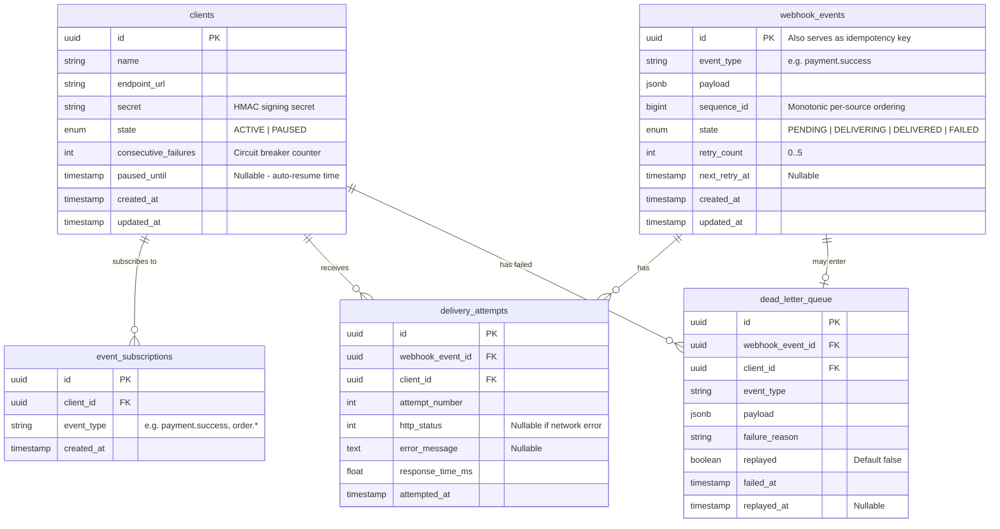
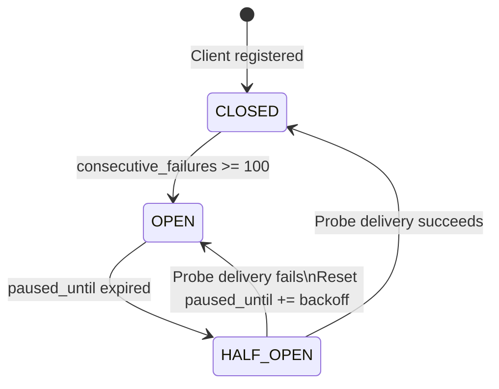
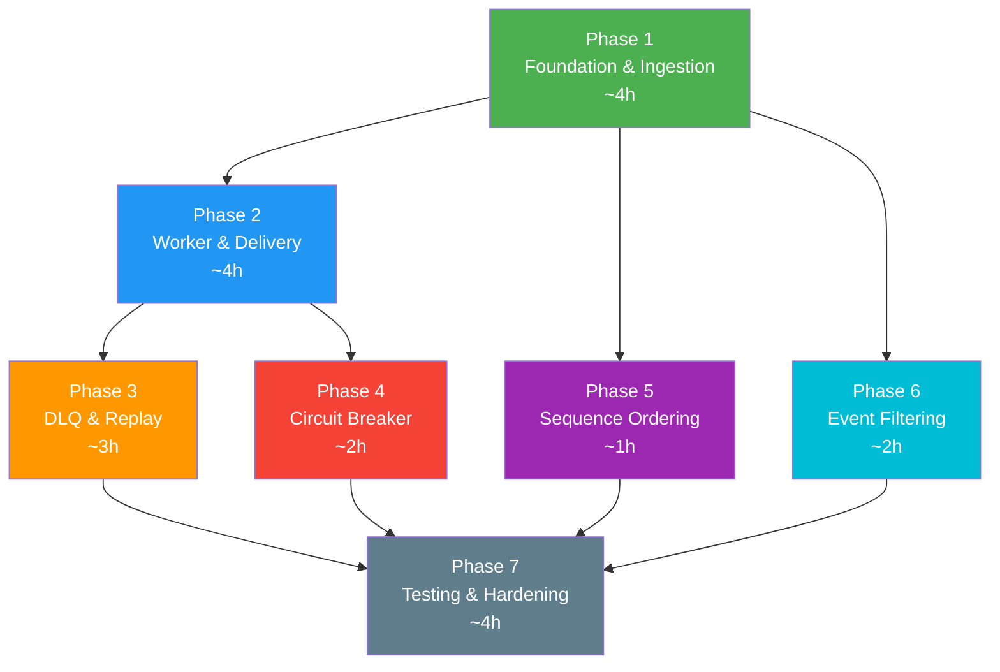

# 🚀 EventPulse — Resilient Webhook Dispatcher System

## Implementation Plan

---

## 1. Architecture Overview

```mermaid
flowchart LR
    subgraph Ingestion
        A["Producer\n(Stripe/Razorpay/GitHub)"] -->|POST /webhooks/ingest| B["FastAPI\nIngestion Endpoint"]
    end

    subgraph Persistence
        B -->|INSERT state=PENDING| C[("PostgreSQL\nwebhook_events")]
    end

    subgraph Queuing
        B -->|task.delay()| D["Redis\nMessage Broker"]
    end

    subgraph Workers
        D --> E["Celery Worker Pool"]
        E -->|"HTTPX POST\n+ X-Signature-SHA256"| F["Recipient\nEndpoint"]
    end

    subgraph "Failure Path"
        E -->|"Retry (exp backoff\n+ full jitter)"| D
        E -->|"Max retries exceeded"| G[("Dead Letter Queue\n(DLQ Table)")]
    end

    subgraph Admin
        H["Admin API"] -->|"Replay / Bulk Re-trigger"| D
        H -->|"Query"| C
        H -->|"Query"| G
    end
```

---

## 2. Project Structure

```
d:\Projects\EventPulse\
├── docker-compose.yml          # PostgreSQL, Redis, Celery worker, FastAPI app
├── Dockerfile
├── pyproject.toml              # Dependencies & project metadata (uv/pip)
├── requirements.txt            # Pinned requirements
├── alembic.ini                 # DB migration config
├── alembic/
│   ├── env.py
│   └── versions/               # Migration scripts
│
├── app/
│   ├── __init__.py
│   ├── main.py                 # FastAPI app factory & lifespan
│   ├── config.py               # Pydantic Settings (env-based config)
│   │
│   ├── api/
│   │   ├── __init__.py
│   │   ├── deps.py             # Dependency injection (DB session, etc.)
│   │   ├── v1/
│   │   │   ├── __init__.py
│   │   │   ├── ingest.py       # POST /webhooks/ingest
│   │   │   ├── admin.py        # Admin: DLQ replay, bulk re-trigger, status
│   │   │   ├── clients.py      # Client CRUD + subscription management
│   │   │   └── health.py       # Health check endpoint
│   │   └── router.py           # Aggregated v1 router
│   │
│   ├── models/
│   │   ├── __init__.py
│   │   ├── base.py             # SQLAlchemy DeclarativeBase
│   │   ├── webhook_event.py    # WebhookEvent model
│   │   ├── delivery_attempt.py # DeliveryAttempt model (audit log)
│   │   ├── dead_letter.py      # DeadLetter model (DLQ)
│   │   ├── client.py           # Client model (endpoint URL, secret, state)
│   │   └── subscription.py     # EventSubscription model (filtering)
│   │
│   ├── schemas/
│   │   ├── __init__.py
│   │   ├── webhook.py          # Pydantic request/response schemas
│   │   ├── client.py           # Client schemas
│   │   └── admin.py            # Admin/DLQ schemas
│   │
│   ├── services/
│   │   ├── __init__.py
│   │   ├── ingestion.py        # Event ingestion business logic
│   │   ├── signature.py        # HMAC-SHA256 signing & verification
│   │   ├── circuit_breaker.py  # Circuit breaker state machine
│   │   └── replay.py           # DLQ replay & bulk re-trigger logic
│   │
│   ├── worker/
│   │   ├── __init__.py
│   │   ├── celery_app.py       # Celery app instance & config
│   │   ├── tasks.py            # deliver_webhook task
│   │   └── retry.py            # Exponential backoff + full jitter calculator
│   │
│   └── db/
│       ├── __init__.py
│       ├── session.py          # Async SQLAlchemy engine & session factory
│       └── utils.py            # DB helpers (transaction wrapper, etc.)
│
├── tests/
│   ├── conftest.py             # Fixtures: test DB, test Redis, httpx mock
│   ├── factories.py            # Factory Boy model factories
│   ├── test_ingest.py          # Ingestion endpoint tests
│   ├── test_delivery.py        # Worker delivery + retry tests
│   ├── test_signature.py       # HMAC signing tests
│   ├── test_circuit_breaker.py # Circuit breaker tests
│   ├── test_dlq.py             # DLQ + replay tests
│   └── test_idempotency.py     # Duplicate event handling tests
│
├── scripts/
│   ├── seed_clients.py         # Seed test clients
│   └── simulate_failures.py    # Load test with simulated failures
│
└── README.md
```

---

## 3. Database Schema Design



### Key Indexes

| Table | Index | Purpose |
|---|---|---|
| `webhook_events` | `ix_events_state_next_retry` on `(state, next_retry_at)` | Efficient polling for retryable events |
| `webhook_events` | `ix_events_event_id` UNIQUE on `(id)` | Idempotency enforcement |
| `webhook_events` | `ix_events_sequence` on `(event_type, sequence_id)` | Out-of-order detection |
| `delivery_attempts` | `ix_attempts_event_client` on `(webhook_event_id, client_id)` | Fast attempt history lookup |
| `dead_letter_queue` | `ix_dlq_replayed` on `(replayed, failed_at)` | DLQ scan for un-replayed events |
| `clients` | `ix_clients_state` on `(state)` | Filter active/paused clients |

---

## 4. Implementation Phases

### Phase 1: Foundation & Ingestion Pipeline
**Estimated effort: ~4 hours**

| Step | Task | Details |
|------|------|---------|
| 1.1 | Project scaffolding | `pyproject.toml` with all deps, Docker Compose (PostgreSQL 16, Redis 7), Dockerfile |
| 1.2 | Config module | `app/config.py` — Pydantic `BaseSettings` loading from `.env`: `DATABASE_URL`, `REDIS_URL`, `HMAC_DEFAULT_SECRET`, `MAX_RETRIES=5`, `DELIVERY_TIMEOUT_SECONDS=3` |
| 1.3 | Database setup | SQLAlchemy 2.0 async engine + session factory, Alembic migrations for all tables |
| 1.4 | Models & schemas | All SQLAlchemy models + Pydantic schemas |
| 1.5 | Ingestion endpoint | `POST /api/v1/webhooks/ingest` — validate payload, generate `event_id` (UUID7 for time-ordered IDs), INSERT with `state=PENDING`, dispatch Celery task, return `202 Accepted` with `event_id` |
| 1.6 | Idempotency guard | Check if `event_id` already exists before insert; if so, return `200 OK` (already accepted) |

> [!NOTE]
> UUID7 is preferred over UUID4 because it's time-ordered, making B-tree index insertions more efficient and enabling natural chronological ordering.

---

### Phase 2: Worker Execution & Delivery
**Estimated effort: ~4 hours**

| Step | Task | Details |
|------|------|---------|
| 2.1 | Celery app setup | `app/worker/celery_app.py` — Redis broker, Redis result backend, task serializer = `json`, `task_acks_late=True`, `worker_prefetch_multiplier=1` |
| 2.2 | HMAC signature service | `app/services/signature.py` — `sign(payload_bytes, secret) → hex_digest`, `verify(payload_bytes, secret, signature) → bool`. Algorithm: `HMAC-SHA256(payload, client_secret)` |
| 2.3 | Delivery task | `app/worker/tasks.py → deliver_webhook` |
| 2.3a | — Fetch event | Load `WebhookEvent` from DB, verify state is `PENDING` or `DELIVERING` |
| 2.3b | — Find recipients | Query `clients` JOIN `event_subscriptions` where `client.state = ACTIVE` and subscription matches `event_type` (support wildcard `order.*`) |
| 2.3c | — HTTP POST | Use `httpx.AsyncClient` with `timeout=3s`. Headers: `Content-Type: application/json`, `X-Event-Id: {event_id}`, `X-Event-Type: {event_type}`, `X-Signature-SHA256: {hmac_hex}`, `X-Sequence-Id: {sequence_id}` |
| 2.3d | — Record attempt | INSERT into `delivery_attempts` with status code, response time, error |
| 2.3e | — Handle success | If `2xx` → update event `state=DELIVERED`, reset client `consecutive_failures=0` |
| 2.3f | — Handle failure | If non-2xx or network error → increment `retry_count`, calculate next delay, schedule retry or move to DLQ |

### Retry Algorithm (Full Jitter)

```
┌─────────────────────────────────────────────────────┐
│  delay = random.uniform(0, min(cap, 2^retry_count)) │
│  cap = 300 seconds (5 minutes)                      │
│  max_retries = 5                                    │
└─────────────────────────────────────────────────────┘
```

| Retry # | Max Delay Window | Example Actual Delay |
|---------|-----------------|---------------------|
| 1 | 0 – 2s | 1.3s |
| 2 | 0 – 4s | 2.7s |
| 3 | 0 – 8s | 5.1s |
| 4 | 0 – 16s | 11.9s |
| 5 | 0 – 32s | 22.4s |
| **FAIL** | → DLQ | — |

> [!TIP]
> **Why Full Jitter instead of Equal Jitter?** Full jitter (`random(0, 2^n)`) provides the best spread across the retry window, minimizing the thundering herd effect when thousands of events for the same client all fail simultaneously. Equal jitter (`2^n/2 + random(0, 2^n/2)`) still clusters retries in the upper half of the window.

---

### Phase 3: Dead Letter Queue & Replay Engine
**Estimated effort: ~3 hours**

| Step | Task | Details |
|------|------|---------|
| 3.1 | DLQ insertion | After max retries exhausted → INSERT event into `dead_letter_queue` with `failure_reason`, mark event `state=FAILED` |
| 3.2 | Admin: List DLQ | `GET /api/v1/admin/dlq` — paginated list with filters: `client_id`, `event_type`, `date_range`, `replayed` |
| 3.3 | Admin: Replay single | `POST /api/v1/admin/dlq/{dlq_id}/replay` — reset event to `PENDING`, `retry_count=0`, re-dispatch Celery task, mark DLQ entry `replayed=true` |
| 3.4 | Admin: Bulk replay | `POST /api/v1/admin/dlq/bulk-replay` — body: `{ "filter": { "client_id": "...", "event_type": "...", "failed_after": "..." } }`. Enqueue all matching DLQ entries with **staggered delays** (not all at once) to prevent thundering herd |
| 3.5 | Admin: Event status | `GET /api/v1/admin/events/{event_id}` — full event detail + all delivery attempts |

> [!WARNING]
> Bulk replay MUST stagger re-dispatches. Implementation: for N events, assign `delay = i * (spread_window / N)` where `spread_window` defaults to 60 seconds. This distributes the load evenly.

---

### Phase 4: Circuit Breaker
**Estimated effort: ~2 hours**



| Step | Task | Details |
|------|------|---------|
| 4.1 | Failure counter | On each failed delivery: `client.consecutive_failures += 1`. On success: reset to `0` |
| 4.2 | Trip to OPEN | If `consecutive_failures >= 100` → set `client.state = PAUSED`, `paused_until = now + 10 minutes` |
| 4.3 | Skip paused clients | In delivery task, skip clients with `state=PAUSED` and `paused_until > now`. Events for paused clients go directly to DLQ with reason `CIRCUIT_BREAKER_OPEN` |
| 4.4 | Half-open probe | Celery Beat periodic task (every 1 min): find clients where `state=PAUSED AND paused_until <= now`, send a single probe delivery. On success → `state=ACTIVE`. On failure → extend `paused_until` with exponential backoff (10min → 20min → 40min, cap 6hr) |
| 4.5 | Admin override | `POST /api/v1/admin/clients/{id}/resume` — manually force client back to `ACTIVE` |

---

### Phase 5: Out-of-Order Delivery Handling
**Estimated effort: ~1 hour**

| Step | Task | Details |
|------|------|---------|
| 5.1 | Sequence ID generation | Monotonically increasing `sequence_id` per event source/type. Use PostgreSQL `SEQUENCE` or application-level counter |
| 5.2 | Include in payload | Add `X-Sequence-Id` header to every delivery so receivers can detect and handle ordering |
| 5.3 | Documentation | Document for clients: "If you receive event with `sequence_id=5` but haven't seen `sequence_id=4`, either buffer or fetch the missing event via our API" |

> [!NOTE]
> **Design decision**: We do NOT enforce ordering at the dispatcher level. This would require per-client FIFO queues which dramatically reduces throughput. Instead, we provide `sequence_id` so receivers can implement their own ordering logic. This is the same approach used by Stripe and GitHub.

---

### Phase 6: Event Filtering & Subscriptions
**Estimated effort: ~2 hours**

| Step | Task | Details |
|------|------|---------|
| 6.1 | Client registration | `POST /api/v1/clients` — register with `endpoint_url`, `secret` (auto-generated if omitted), and list of `event_types` (supports wildcards: `payment.*`, `*`) |
| 6.2 | Subscription CRUD | `PUT /api/v1/clients/{id}/subscriptions` — update subscribed event types |
| 6.3 | Filter in delivery | When dispatching, only deliver to clients whose subscriptions match the event type. Matching logic: exact match OR wildcard prefix match (`order.*` matches `order.created`, `order.cancelled`) |
| 6.4 | List available events | `GET /api/v1/event-types` — returns all known event types from historical data |

---

### Phase 7: Testing & Hardening
**Estimated effort: ~4 hours**

| Step | Task | Details |
|------|------|---------|
| 7.1 | Test fixtures | `conftest.py`: async test DB (SQLite or test PostgreSQL), mock Redis, `httpx` responder mocks |
| 7.2 | Unit tests | Signature signing/verification, retry delay calculator, circuit breaker state transitions, wildcard subscription matching |
| 7.3 | Integration tests | Full ingestion → delivery → success flow, ingestion → delivery → failure → retry → DLQ flow, DLQ replay flow, circuit breaker trip and recovery flow, idempotent re-ingestion, bulk replay with staggering |
| 7.4 | Edge case tests | Thundering herd: 10k events for same client, verify jitter spreads retries. Duplicate `event_id` submission. Delivery to paused client. Concurrent delivery attempts for same event (use DB-level `SELECT ... FOR UPDATE SKIP LOCKED`) |
| 7.5 | Load test script | `scripts/simulate_failures.py` — spin up a mock server that returns 500 for N% of requests, ingest 10k events, verify DLQ and circuit breaker behavior |

---

## 5. Tech Stack & Dependencies

```toml
[project]
name = "eventpulse"
requires-python = ">=3.10"

dependencies = [
    "fastapi>=0.115.0",
    "uvicorn[standard]>=0.30.0",
    "celery[redis]>=5.4.0",
    "redis>=5.0.0",
    "sqlalchemy[asyncio]>=2.0.0",
    "asyncpg>=0.29.0",           # Async PostgreSQL driver
    "alembic>=1.13.0",
    "httpx>=0.27.0",
    "pydantic>=2.9.0",
    "pydantic-settings>=2.5.0",
    "uuid7>=0.1.0",              # Time-ordered UUIDs
]

[project.optional-dependencies]
dev = [
    "pytest>=8.0.0",
    "pytest-asyncio>=0.24.0",
    "pytest-celery>=1.0.0",
    "factory-boy>=3.3.0",
    "httpx",                     # TestClient
    "respx>=0.21.0",             # HTTPX mocking
    "faker>=28.0.0",
]
```

---

## 6. Docker Compose Services

| Service | Image | Ports | Purpose |
|---------|-------|-------|---------|
| `api` | Custom Dockerfile | `8000:8000` | FastAPI app (uvicorn) |
| `worker` | Same image, different entrypoint | — | Celery worker |
| `beat` | Same image, different entrypoint | — | Celery Beat (circuit breaker probes) |
| `postgres` | `postgres:16-alpine` | `5432:5432` | Primary database |
| `redis` | `redis:7-alpine` | `6379:6379` | Message broker + result backend |

---

## 7. API Endpoint Summary

| Method | Endpoint | Purpose | Auth |
|--------|----------|---------|------|
| `POST` | `/api/v1/webhooks/ingest` | Receive & queue webhook event | API Key |
| `GET` | `/api/v1/admin/events/{event_id}` | Event status + delivery history | Admin |
| `GET` | `/api/v1/admin/dlq` | List dead-letter events (paginated) | Admin |
| `POST` | `/api/v1/admin/dlq/{dlq_id}/replay` | Replay single DLQ event | Admin |
| `POST` | `/api/v1/admin/dlq/bulk-replay` | Bulk replay with staggering | Admin |
| `POST` | `/api/v1/clients` | Register new client | Admin |
| `GET` | `/api/v1/clients` | List all clients | Admin |
| `GET` | `/api/v1/clients/{id}` | Client detail + circuit breaker state | Admin |
| `PUT` | `/api/v1/clients/{id}/subscriptions` | Update event subscriptions | Admin |
| `POST` | `/api/v1/admin/clients/{id}/resume` | Force-resume paused client | Admin |
| `GET` | `/api/v1/event-types` | List known event types | Admin |
| `GET` | `/api/v1/health` | Health check (DB + Redis + Worker) | Public |

---

## 8. Build Order & Dependency Graph



**Total estimated effort: ~20 hours**

**Critical path**: Phase 1 → Phase 2 → Phase 3 → Phase 7

---

## 9. Key Design Decisions

| Decision | Choice | Rationale |
|----------|--------|-----------|
| Async HTTP client | `httpx` over `requests` | Non-blocking delivery, connection pooling, timeout control |
| Task acknowledgment | `acks_late=True` | Worker crash won't lose events; task re-delivered to another worker |
| Prefetch | `prefetch_multiplier=1` | Prevents one worker from hogging tasks during slow deliveries |
| Jitter algorithm | Full jitter | Best thundering herd mitigation (AWS recommended) |
| Ordering strategy | Sequence IDs (receiver-side) | Dispatcher-side ordering kills parallelism; receivers handle it |
| Circuit breaker scope | Per-client | Prevents one bad client from affecting others |
| DLQ as DB table | PostgreSQL table, not Redis | Queryable, filterable, auditable, survives Redis flush |
| Event ID format | UUID7 | Time-ordered for efficient indexing + globally unique |

---

## 10. Interview Edge Cases — Ready Answers

| Question | Answer |
|----------|--------|
| **Thundering herd?** | Full jitter: `delay = random(0, 2^retry)`. 10k events spread uniformly across the window, not clustered. |
| **Out-of-order delivery?** | `sequence_id` in payload + header. Receiver buffers or fetches missing events. Same as Stripe's approach. |
| **Worker crash mid-delivery?** | `acks_late=True` — message returns to queue, picked up by another worker. DB state still `DELIVERING`, re-entrant task checks and continues. |
| **Duplicate processing?** | Unique `event_id` + DB unique constraint. Receiver checks `X-Event-Id` for idempotency. |
| **Poison pill event?** | Max 5 retries then DLQ. Circuit breaker prevents cascade. |
| **Redis goes down?** | `webhook_events` table is source of truth with `state` + `next_retry_at`. A recovery sweep task (Celery Beat) re-enqueues `PENDING`/`DELIVERING` events older than threshold. |
| **DB transaction isolation?** | `SELECT ... FOR UPDATE SKIP LOCKED` prevents two workers from grabbing the same event. |
| **Monitoring?** | Expose Prometheus metrics: events ingested/sec, delivery success/failure rate, DLQ size, circuit breaker trips, retry queue depth, p99 delivery latency. |

