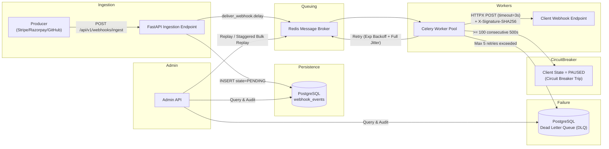

# 🚀 EventPulse — Resilient Webhook Dispatcher System

A production-grade, highly resilient webhook dispatching and retry system built with **Python 3.10+, FastAPI, Celery, Redis, and PostgreSQL / SQLAlchemy 2.0 (Async)**.

---

## 📌 The Real-World Problem Solved

When platforms like Stripe, Razorpay, or GitHub broadcast webhooks to external recipient servers:
1. **Recipient Flakiness**: External webhooks frequently experience network blips, 500 server crashes, or slow responses.
2. **Thread Pool Exhaustion**: Synchronous webhook delivery locks worker processes, rapidly exhausting thread pools and causing downstream cascading service failures.
3. **Thundering Herd On Retries**: If 10,000 webhooks fail for a client simultaneously, retrying them at deterministic exponential intervals hits the recovering server with 10,000 concurrent requests at the exact same millisecond, crashing it again.
4. **Out-of-Order Delivery**: If `order.created` fails and goes into retry while `order.cancelled` succeeds immediately, downstream systems process events out of sequence.

---

## 🏗️ Core Architecture & Blueprint



---

## 🔑 Key Architectural Features

### 1. Ingestion Pipeline & Idempotency
- **Endpoint**: `POST /api/v1/webhooks/ingest`
- Generates or accepts a unique `event_id` (idempotency key).
- Persists event to `webhook_events` with initial state `PENDING`.
- If an event with the same `event_id` is re-submitted, returns `200 OK` (`ALREADY_PROCESSED`) without duplicating delivery.
- Asynchronously triggers Celery worker via Redis message broker.

### 2. Cryptographic Authenticity (HMAC-SHA256)
- Every outbound webhook attaches the header:
  ```http
  X-Signature-SHA256: <hex_digest>
  ```
- Generated via:
  $$\text{Signature} = \text{HMAC-SHA256}(\text{canonical\_payload}, \text{client\_secret})$$
- Serializes JSON with sorted keys to ensure deterministic signatures.
- Uses constant-time comparison (`hmac.compare_digest`) to prevent timing attacks.

### 3. Exponential Backoff with Full Jitter
To solve the **Thundering Herd Problem**, retries are uniformly randomized across the exponential window:
$$\text{Delay} = \text{random.uniform}(0.1, \min(\text{cap}, 2^{\text{retry\_count}}))$$
- **Cap**: 300 seconds (5 minutes).
- **Max Retries**: 5.
- If 10,000 webhooks fail simultaneously, retries are smoothly smeared across the timeline rather than spiking at fixed intervals.

### 4. Per-Client Auto Circuit Breaker
- Tracks consecutive failures per client.
- When `consecutive_failures >= 100`, the client is set to `PAUSED` state with `paused_until = now + 10 minutes`.
- Further events for that client immediately route to the DLQ (`CIRCUIT_BREAKER_OPEN`), protecting the external server from being overwhelmed.
- Periodic probe (Half-Open) attempts delivery when `paused_until` expires. If the probe succeeds, the client auto-resumes `ACTIVE`.
- Manual override: `POST /api/v1/clients/{id}/resume`.

### 5. Out-of-Order Delivery & Sequence IDs
- Dispatching strictly in FIFO per-client hurts throughput.
- EventPulse attaches `X-Sequence-Id: <monotonic_id>` to all payloads and headers (same pattern as Stripe and GitHub).
- Receivers can buffer out-of-order events or fetch missing events if sequence gaps are observed.

### 6. Dead Letter Queue (DLQ) & Staggered Bulk Replay
- Events that exhaust 5 retries move to the `dead_letter_queue` table in PostgreSQL.
- **Admin API**:
  - `GET /api/v1/admin/dlq`: Filterable by `client_id`, `event_type`, date range, and `replayed` status.
  - `POST /api/v1/admin/dlq/{id}/replay`: Replay a single failed event.
  - `POST /api/v1/admin/dlq/bulk-replay`: Bulk replays failed events **with staggered delays** across a specified time window (`spread_window_seconds`), preventing re-triggering the thundering herd.

### 7. Event Filtering & Wildcard Subscriptions
- Clients subscribe to specific events:
  - Exact match: `"payment.success"`
  - Prefix wildcard: `"payment.*"` (matches `"payment.created"`, `"payment.refunded"`)
  - Universal wildcard: `"*"` (receives all events)

---

## 📁 Project Layout

```
EventPulse/
├── app/
│   ├── api/
│   │   ├── v1/
│   │   │   ├── admin.py            # DLQ listing, replay, audit
│   │   │   ├── clients.py          # Client & subscription management
│   │   │   ├── health.py           # DB & Redis connectivity health check
│   │   │   ├── ingest.py           # POST /webhooks/ingest
│   │   │   └── router.py           # Aggregated v1 routes
│   │   ├── deps.py                 # DB session & API key security
│   │   └── router.py
│   ├── db/
│   │   └── session.py              # Async SQLAlchemy engine & sessionmaker
│   ├── models/
│   │   ├── base.py                 # DeclarativeBase & UUID generator
│   │   ├── client.py               # Client model with circuit breaker state
│   │   ├── dead_letter.py          # DLQ model
│   │   ├── delivery_attempt.py     # Attempt audit log with timing
│   │   ├── subscription.py         # Client event subscriptions
│   │   └── webhook_event.py        # WebhookEvent with sequence_id & state
│   ├── schemas/                    # Pydantic v2 schemas
│   ├── services/
│   │   ├── circuit_breaker.py      # Circuit breaker state machine
│   │   ├── ingestion.py            # Idempotent ingestion pipeline
│   │   ├── replay.py               # Staggered DLQ replay engine
│   │   └── signature.py            # HMAC-SHA256 signer & verifier
│   ├── worker/
│   │   ├── celery_app.py           # Celery configuration
│   │   ├── retry.py                # Full Jitter backoff algorithm
│   │   └── tasks.py                # Async HTTPX delivery & Celery tasks
│   ├── config.py                   # Pydantic Settings
│   └── main.py                     # FastAPI application factory & lifespan
├── scripts/
│   ├── seed_clients.py             # Seed demo clients
│   └── simulate_failures.py        # Test failure & DLQ simulation
├── tests/                          # 17 automated unit and integration tests
├── Dockerfile
├── docker-compose.yml
├── pyproject.toml
├── requirements.txt
├── IMPLEMENTATION_PLAN.md
└── README.md
```

---

## ⚡ Quick Start Guide

### 1. Local Setup with Virtualenv

```bash
# 1. Clone & create venv
python -m venv .venv
.\.venv\Scripts\activate

# 2. Install dependencies
pip install -r requirements.txt

# 3. Seed demo clients
python scripts/seed_clients.py

# 4. Run automated tests (17 passed)
python -m pytest -v

# 5. Run failure & retry simulation
python scripts/simulate_failures.py

# 6. Start FastAPI server
uvicorn app.main:app --reload --port 8000
```

### 2. Docker Compose (Full Stack)

To run FastAPI, PostgreSQL, Redis, Celery Worker, and Celery Beat together:

```bash
docker compose up -d --build
```

---

## 📡 API Reference & Examples

### Ingest a Webhook
```bash
POST /api/v1/webhooks/ingest
Content-Type: application/json

{
  "event_id": "evt_9988223344",
  "event_type": "payment.success",
  "payload": {
    "customer": "cust_1001",
    "amount": 4999,
    "currency": "USD"
  },
  "sequence_id": 104
}
```

**Response (`202 Accepted`)**:
```json
{
  "event_id": "evt_9988223344",
  "status": "ACCEPTED",
  "message": "Event accepted for delivery and queued."
}
```

### Register a Webhook Subscriber Client
```bash
POST /api/v1/clients
X-Admin-Key: eventpulse_admin_secret_token
Content-Type: application/json

{
  "name": "Acme Corp Webhook Receiver",
  "endpoint_url": "https://api.acme.com/webhooks",
  "event_types": ["payment.*", "invoice.paid"]
}
```

### Staggered Bulk Replay from DLQ
```bash
POST /api/v1/admin/dlq/bulk-replay
X-Admin-Key: eventpulse_admin_secret_token
Content-Type: application/json

{
  "filter": {
    "event_type": "payment.success"
  },
  "spread_window_seconds": 60.0
}
```

**Response (`200 OK`)**:
```json
{
  "total_matching": 120,
  "replayed_count": 120,
  "spread_window_seconds": 60.0,
  "stagger_interval_seconds": 0.5,
  "message": "Successfully scheduled 120 DLQ events staggered across 60.0s."
}
```

---

## 🧪 Test Suite Summary

Run all tests:
```bash
python -m pytest -v
```

17 automated tests verify every component:
- ✅ `test_circuit_breaker_transitions`: Failure threshold tripping, PAUSED state, HALF-OPEN probe, and recovery.
- ✅ `test_circuit_breaker_force_resume`: Admin manual reset override.
- ✅ `test_successful_delivery_flow`: HTTPX async delivery, response timing, HMAC-SHA256 header validation.
- ✅ `test_failure_retry_and_dlq_flow`: 500 error backoff, retry counting, and DLQ insertion upon reaching max retries.
- ✅ `test_dlq_list_and_single_replay`: Single DLQ item replay and state reset to PENDING.
- ✅ `test_dlq_bulk_replay_staggered`: Multi-item staggered replay rate limiting.
- ✅ `test_health_check`: Database & broker health checks.
- ✅ `test_ingest_webhook_new_and_idempotency`: Duplicate detection and idempotency guarantee.
- ✅ `test_client_crud_and_subscriptions`: Registration, subscription filtering, and updates.
- ✅ `test_calculate_full_jitter_delay_range`: Full Jitter variance and bounds.
- ✅ `test_calculate_full_jitter_delay_cap`: Cap enforcement at 300s.
- ✅ `test_generate_secret`: Cryptographic hex secret generation.
- ✅ `test_compute_and_verify_signature_dict`: HMAC-SHA256 signing and tamper detection.
- ✅ `test_signature_deterministic_key_ordering`: Key order invariance in JSON serialization.
- ✅ `test_matches_subscription_*`: Wildcard matching (`*`, `payment.*`, exact).

