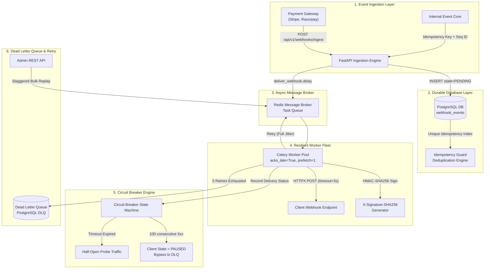
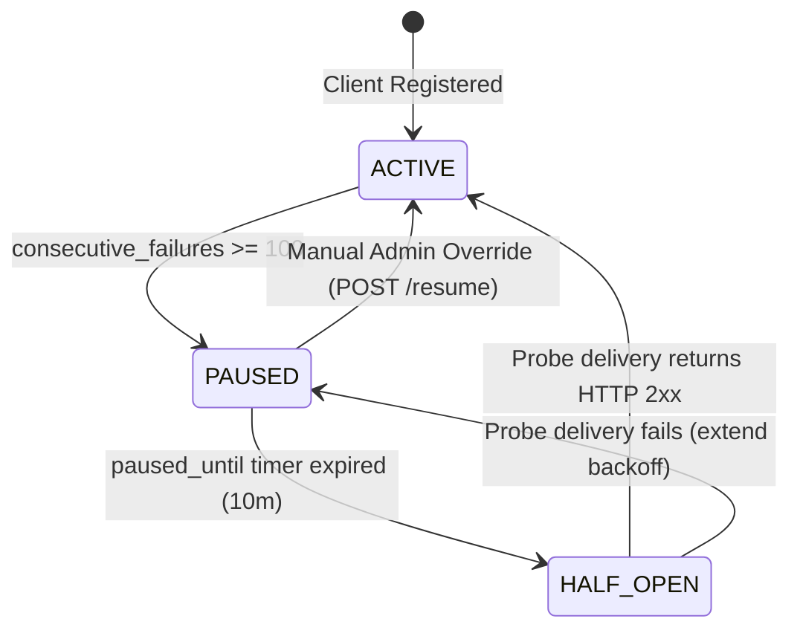

<div align="center">

# ⚡ EventPulse
### Resilient, Distributed Webhook Dispatcher System
**Zero Event Loss • Thundering Herd Immunity • Cryptographic HMAC • Per-Client Circuit Breaking**

[](https://github.com/MohdArshad-cell/EventPulse/actions/workflows/ci.yml)
[](https://www.python.org/)
[](https://fastapi.tiangolo.com)
[](https://docs.celeryq.dev/)
[](https://redis.io/)
[](https://www.postgresql.org/)
[](https://docs.sqlalchemy.org/)
[](https://opensource.org/licenses/MIT)

---

</div>

## 📌 The Real-World Engineering Problem

When hyper-growth platforms (like **Stripe**, **Razorpay**, or **GitHub**) dispatch webhook events to external consumer systems, they encounter hostile real-world network conditions:

1. **Thread Pool Starvation**: Sending webhooks synchronously blocks application workers. If consumer endpoints respond slowly or hang, thread pools exhaust in seconds, causing total system outages.
2. **Permanent Event Loss**: Without persistent queuing and transaction boundaries, failures during delivery permanently drop events.
3. **The Thundering Herd Disaster**: If 10,000 webhooks fail during client downtime, retrying them with standard exponential intervals (`2^n`) clusters all 10,000 requests into the exact same millisecond window, repeatedly crashing the recovering server.
4. **Out-of-Order Execution**: If `order.created` fails and goes into retry while `order.cancelled` succeeds immediately, downstream subscriber applications corrupt their internal state.
5. **Cascading Server Overload**: When an external client server completely dies, continuously hammering it with doomed deliveries wastes network bandwidth and broker resources.

---

## 🏛️ System Architecture



---

## 🔬 Architectural Deep Dives & Edge Case Solutions

### 1. Thundering Herd Mitigation: Full Jitter Algorithm

Standard exponential backoff clusters retries. Equal jitter helps but still biases retries toward the tail of each window. **EventPulse implements AWS-recommended Full Jitter**:

```math
\text{MaxInterval} = \min(\text{Cap}, 2^{\text{retry}})
```
```math
\text{Delay} = \text{random}(0.1, \text{MaxInterval})
```

| Retry # | Window | Standard Exp Backoff | Equal Jitter | EventPulse Full Jitter |
|:---:|:---:|:---:|:---:|:---:|
| 1 | 0.1s – 2.0s | Exactly 2.0s *(herd spikes)* | 1.0s – 2.0s | **0.1s – 2.0s (Uniform Spread)** |
| 2 | 0.1s – 4.0s | Exactly 4.0s *(herd spikes)* | 2.0s – 4.0s | **0.1s – 4.0s (Uniform Spread)** |
| 3 | 0.1s – 8.0s | Exactly 8.0s *(herd spikes)* | 4.0s – 8.0s | **0.1s – 8.0s (Uniform Spread)** |
| 4 | 0.1s – 16.0s | Exactly 16.0s *(herd spikes)* | 8.0s – 16.0s | **0.1s – 16.0s (Uniform Spread)** |
| 5 | 0.1s – 32.0s | Exactly 32.0s *(herd spikes)* | 16.0s – 32.0s | **0.1s – 32.0s (Uniform Spread)** |
| > 5 | — | — | — | **Moved to DLQ** |

---

### 2. Cryptographic Authenticity (HMAC-SHA256)
Every outbound payload is signed with the client's secret key:

```math
\text{Signature} = \text{HMAC-SHA256}(\text{CanonicalPayload}, \text{ClientSecret})
```

- **Constant-Time Verification**: `hmac.compare_digest` prevents timing attacks.
- **Key Invariance**: Payloads are formatted with sorted keys (`sort_keys=True`) ensuring identical digests regardless of field ordering.

Attached headers:
```http
POST /webhook HTTP/1.1
Host: client.api.com
Content-Type: application/json
X-Event-Id: 0192e4ab-3012-78d1-b541-fa7289028a1c
X-Event-Type: payment.success
X-Signature-SHA256: 3a28f8045b6db763e1f0e210dc41144f8f30c6a992688463c6cfce797f1f9172
X-Sequence-Id: 48912
```

---

### 3. Per-Client Circuit Breaker State Machine



- **Fail-Fast DLQ Routing**: While in `PAUSED` state, newly ingested events bypass network calls and land directly in the DLQ with reason `CIRCUIT_BREAKER_OPEN`.
- **Half-Open Probes**: When the pause timeout elapses, the client allows a test delivery probe to verify endpoint recovery without overwhelming it.

---

### 4. Out-of-Order Delivery: Sequence IDs
Enforcing strictly ordered FIFO queues per customer creates head-of-line blocking that ruins throughput. 
EventPulse follows the **Stripe & GitHub Industry Pattern**:
- Every event includes a monotonic `sequence_id`.
- If client receives event `sequence_id=5` before `sequence_id=4`, client buffers the event or fetches the missing event via the audit API.

---

### 5. Dead Letter Queue & Staggered Bulk Replay

When an incident is resolved on the recipient's side, replaying 5,000 failed webhooks simultaneously would immediately re-trigger a thundering herd. 

EventPulse provides **Rate-Staggered Bulk Replay**:

```math
\text{StaggerInterval} = \frac{\text{SpreadWindowSeconds}}{\text{TotalEvents}}
```

Tasks are scheduled across Redis using delayed countdowns (`countdown = i * stagger`), smoothly throttling re-delivery.

---

## 🚀 Quickstart Guide

### Option A: Local Development (SQLite & In-Memory Redis)

```bash
# 1. Clone repository
git clone https://github.com/MohdArshad-cell/EventPulse.git
cd EventPulse

# 2. Set up virtual environment
python -m venv .venv
.\.venv\Scripts\activate   # Windows
# source .venv/bin/activate # Linux/macOS

# 3. Install dependencies
pip install -r requirements.txt

# 4. Seed demo clients with subscriptions
python scripts/seed_clients.py

# 5. Run the full test suite (18 tests)
python -m pytest -v

# 6. Start the API server
uvicorn app.main:app --reload --port 8000
```

### Option B: Production Docker Compose (PostgreSQL 16 + Redis 7 + Celery)

```bash
docker compose up -d --build
```
Services deployed:
- `api`: FastAPI on `http://localhost:8000`
- `worker`: Celery worker fleet (`--concurrency=4`)
- `beat`: Celery Beat periodic circuit breaker sweep
- `postgres`: PostgreSQL 16 on `5432`
- `redis`: Redis 7 on `6379`

---

## 🛠️ Interactive Tooling & Testing

### 1. Interactive Mock Webhook Receiver CLI
Test webhook delivery and cryptographic verification locally:
```bash
# Terminal 1: Start Mock Receiver listening on port 9000
python scripts/mock_receiver.py --port 9000

# Terminal 2: Test simulating 500 crashes
python scripts/mock_receiver.py --port 9000 --status 500

# Terminal 3: Test simulating high network latency (4s timeout)
python scripts/mock_receiver.py --port 9000 --delay 4.0
```

### 2. Failure & DLQ Load Simulator
Watch retries, jitter delays, and DLQ movement in real-time:
```bash
python scripts/simulate_failures.py
```

---

## 📡 REST API Reference

| Method | Endpoint | Description | Auth |
|:---:|---|---|:---:|
| `POST` | `/api/v1/webhooks/ingest` | Idempotent webhook ingestion (`202 Accepted` / `200 OK`) | — |
| `GET` | `/api/v1/admin/events/{id}` | Complete audit trail & delivery attempt timings | `X-Admin-Key` |
| `GET` | `/api/v1/admin/dlq` | Query Dead Letter Queue (filtered by client/event/date) | `X-Admin-Key` |
| `POST` | `/api/v1/admin/dlq/{id}/replay` | Replay a single failed event | `X-Admin-Key` |
| `POST` | `/api/v1/admin/dlq/bulk-replay` | Staggered bulk replay across rate-limited time window | `X-Admin-Key` |
| `POST` | `/api/v1/clients` | Register a new client & HMAC secret | `X-Admin-Key` |
| `GET` | `/api/v1/clients` | List all subscribers & circuit breaker states | `X-Admin-Key` |
| `PUT` | `/api/v1/clients/{id}/subscriptions` | Update subscribed event patterns (`payment.*`, `*`) | `X-Admin-Key` |
| `POST` | `/api/v1/clients/{id}/resume` | Manual circuit breaker override (PAUSED -> ACTIVE) | `X-Admin-Key` |
| `GET` | `/metrics` | Prometheus metrics scrape endpoint | Public |
| `GET` | `/api/v1/health` | Comprehensive DB, Redis, and broker health check | Public |

### Ingestion Example
```bash
curl -X POST "http://localhost:8000/api/v1/webhooks/ingest" \
  -H "Content-Type: application/json" \
  -d '{
    "event_id": "evt_live_998822",
    "event_type": "payment.success",
    "payload": {
      "customer_id": "cust_901",
      "amount": 7500,
      "currency": "INR"
    },
    "sequence_id": 105
  }'
```

**Response (`202 Accepted`)**:
```json
{
  "event_id": "evt_live_998822",
  "status": "ACCEPTED",
  "message": "Event accepted for delivery and queued."
}
```

---

## 📊 Observability & Prometheus Metrics

Scrape metrics on `/metrics`:
```prometheus
# HELP eventpulse_events_ingested_total Total webhook events received and queued
# TYPE eventpulse_events_ingested_total counter
eventpulse_events_ingested_total{event_type="payment.success"} 4210

# HELP eventpulse_deliveries_success_total Total successful webhook deliveries (HTTP 2xx)
# TYPE eventpulse_deliveries_success_total counter
eventpulse_deliveries_success_total{client_id="c_1",event_type="payment.success"} 4180

# HELP eventpulse_circuit_breaker_trips_total Total times client circuit was tripped to PAUSED
# TYPE eventpulse_circuit_breaker_trips_total counter
eventpulse_circuit_breaker_trips_total{client_id="c_2"} 1

# HELP eventpulse_unreplayed_dlq_gauge Total unreplayed events in Dead Letter Queue
# TYPE eventpulse_unreplayed_dlq_gauge gauge
eventpulse_unreplayed_dlq_gauge 3
```

---

## 📜 License
This project is open-source software licensed under the [MIT License](LICENSE).
